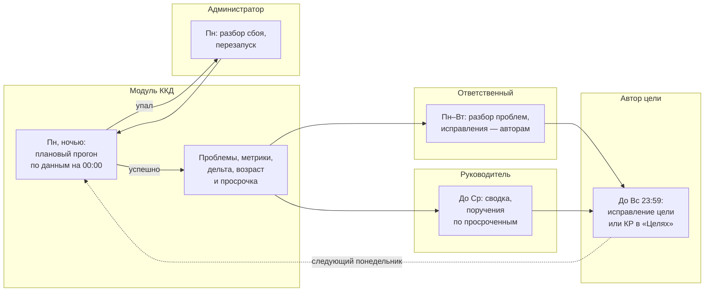
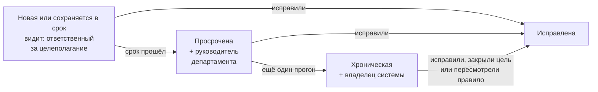

# Контроль качества данных по целям: требования к модулю ККД

Тестовое задание на стажировку, направление «Бизнес-аналитик». Кейс «Контроль качества данных по целям сотрудников».

> **Как читать.** Разделы 1–5 — пункты задания, раздел 6 — мотивация. Нумерация для ссылок: вопросы В1–В7, допущения Д1–Д7, правила П1–П4, сценарии С1–С4. Коды правил и метрик (`GOAL_NO_KR`, `clean_goals_share`…) — общие имена для бизнеса, системного аналитика и разработки, они совпадают со справочником mock API модуля ККД из материалов проекта.

## 0. Коротко о задаче

**Проблема бизнеса.** Руководство ставит цели сверху вниз: блок → департамент → подразделение → сотрудник. Как идёт работа над целями, руководители видят по данным системы управления целями. Если цель заведена без ключевых результатов (КР), веса КР не складываются в 100%, цель не привязана к вышестоящей или факт по КР давно не обновлялся, руководитель видит не реальную картину, а искажённую. Сейчас ККД считает технические метрики, но не говорит, что именно не так, у кого и что исправлять.

**Что должен дать модуль.** Раз в неделю проверить все активные цели и их КР набором правил и показать: (1) насколько данные в порядке — три метрики с динамикой; (2) список конкретных проблем — где, что не так, кто исправляет и как; (3) что изменилось с прошлой проверки — что исправили, что появилось, что висит. По этому списку руководитель департамента раздаёт поручения, и к следующей проверке картина становится лучше.

**Границы.** Модуль только находит и показывает проблемы, исправляют их люди в модуле «Цели». Модуль не оценивает содержание цели (амбициозность, формулировку) и не считает выполнение целей — только формальную корректность данных.

### Стейкхолдеры

| Роль | Что делает в процессе ККД | Что ему важно |
|---|---|---|
| Владелец системы управления целями (заказчик) | Утверждает правила, важность, пороги и сроки. Принимает модуль. Решает судьбу хронических проблем | Руководство видит реальную картину, правила одни для всех |
| Администратор системы | Следит за еженедельным прогоном, перезапускает упавший, отвечает пользователям, настраивает доступы | Прогон проходит вовремя, при сбое понятно, что делать |
| Руководитель департамента | Смотрит сводку по департаменту, ставит поручения по просроченным проблемам | Видеть, где плохо и кому поручить, не разбирая каждую цель самому |
| Ответственный за целеполагание в подразделении | Каждую неделю разбирает список проблем подразделения, раздаёт исправления, следит за сроками | Готовый список «кто что исправляет» с понятной рекомендацией |
| Автор цели (ответственный за цель) | Исправляет свою цель или КР в модуле «Цели» | За минуту понять, что не так и как исправить |

### Словарь

- **Активная цель** — цель в статусе `active`. Черновики (`draft`), закрытые (`closed`) и отменённые (`cancelled`) цели не проверяются и в метрики не входят.
- **Каскад** — связь цели с родительской целью вышестоящего уровня: блок → департамент → подразделение → сотрудник. У цели блока родителя нет, она — вершина.
- **Прогон** — одна проверка снимка данных всеми правилами, плановый — раз в неделю. Бывает успешным или упавшим.
- **Проблема** — одно нарушение одного правила одним объектом (целью или КР). Между прогонами проблема считается «той же самой», если совпадают код правила и объект.
- **Периметр** — подразделение вместе со всеми дочерними: метрики департамента включают цели департамента, его подразделений и их сотрудников.
- **Возраст проблемы** — сколько успешных прогонов подряд проблема находится. В прогоне, где её нашли впервые, возраст = 1.

### Допущения

Действуют, пока нет ответов на вопросы раздела 1. Каждое привязано к своему вопросу.

| № | Допущение | Вопрос |
|---|---|---|
| Д1 | Проверяем только активные цели и их КР. Период целеполагания — календарный год | В1 |
| Д2 | Исправляет автор цели. За результат по подразделению отвечает ответственный за целеполагание | В2 |
| Д3 | Сумма весов КР — ровно 100%, веса — целые проценты, допуск 0. Итоговое выполнение цели считается по весам КР | В3 |
| Д4 | Каждая активная цель ниже уровня блока обязана иметь родительскую цель. Привязка «через уровень» внутри своей ветки (сотрудник → департамент) допустима. Исключений нет | В4 |
| Д5 | Дата последнего обновления факта КР хранится в системе. Факт устарел, если не обновлялся более 45 дней | В5 |
| Д6 | Плановый прогон — в понедельник ночью по данным на 00:00. Упавший прогон администратор перезапускает в тот же рабочий день | В6 |
| Д7 | Срок исправления зависит от важности (раздел 4). Каждый видит свою ветку оргструктуры, администратор и владелец — весь блок. Автоуведомлений в первой версии нет, есть выгрузка списка проблем | В7 |

## 1. Вопросы к заказчику и стейкхолдерам

Первыми идут вопросы, без которых нельзя однозначно записать правила и метрики (В1–В5). Затем — вопросы о процессе (В6–В7): без них модуль заработает, но проблемы не будут исправляться.

| № | Вопрос | Кому | Зачем | Какой риск закрываем |
|---|---|---|---|---|
| В1 | Какие цели проверяем: только `active`? Входят ли незакрытые цели прошлого периода? Период целеполагания — год или квартал? | Владелец системы | Определить, что попадает в проверку и в знаменатель всех метрик | Метрики считаются «не по тем» целям: доля корректных завышена или занижена, черновики дают ложные проблемы |
| В2 | Кто исправляет проблему: автор цели, его руководитель или ответственный за целеполагание? Может ли ответственный исправлять чужие цели сам? Кто исправляет, если у цели нет ответственного? | Руководитель департамента, ответственный за целеполагание | Назначить исполнителя по каждому правилу (RACI в разделе 4) | Проблема «ничья» и висит прогон за прогоном: модуль показывает, но ничего не меняется |
| В3 | Сумма весов КР — ровно 100% или допускается округление (99–101%)? Итоговое выполнение цели считается по весам КР? | Владелец системы | Задать точный порог правила П2 и обосновать его важность | Ложные срабатывания из-за округления — пользователи перестают доверять модулю |
| В4 | Обязана ли каждая цель ниже блока иметь родительскую цель? Есть ли исключения: цели развития сотрудника, проектные цели, подразделения в реорганизации? Можно ли привязаться «через уровень»? | Владелец системы, руководитель департамента | Задать правило на каскад П3 и знаменатель метрики «Покрытие каскадом» | Во время реорганизации — сотни ложных «сломанных каскадов», метрика каскада теряет смысл |
| В5 | Хранится ли дата последнего обновления факта КР? Как часто факт должен обновляться — раз в месяц, раз в квартал? Можно ли подтвердить факт, если он не изменился? | Администратор системы (про данные), владелец системы (про норму) | Проверить, что правило П4 вообще можно сделать, и подтвердить порог 45 дней | Без даты правило не реализовать. Если факт обновляют раз в квартал, все такие КР попадут в «устаревшие» |
| В6 | Что делаем, если еженедельный прогон упал или данные пришли не полностью: кто узнаёт, кто перезапускает и к какому сроку? Что видят руководители, пока свежего прогона нет? | Администратор системы | Описать обработку сбоя в процессе и на странице | Руководитель видит пустую страницу или ложную дельту: «исправлено 100 проблем», которые никто не исправлял, — просто часть данных не загрузилась |
| В7 | Какой срок на исправление для каждой важности и кому эскалировать просрочку? Нужны ли уведомления и выгрузка списка для поручений? Кто какие подразделения видит? | Руководитель департамента, владелец системы | Зафиксировать сроки, эскалацию и границы первой версии | Модуль есть, но страницу никто не открывает. Объём растёт по ходу разработки за счёт «а ещё нужно…» |

## 2. Каталог правил ККД

### Общие правила проверки

- Проверяются только активные цели и КР активных целей.
- Одна проблема — одно правило и один объект. Идентификатор проблемы постоянный: «код правила + идентификатор объекта», по нему видно, новая проблема, сохраняется или исправлена. Проблема хранит факт, ожидание, рекомендацию и ответственного за цель.
- Если у цели нет КР (П1), сумму весов (П2) не проверяем: у одной причины — одна проблема.

### Шкала важности

Важность определяется тем, насколько проблема искажает картину для руководства.

| Важность | Критерий | Срок исправления |
|---|---|---|
| Критичная (`critical`) | По цели невозможно оценить выполнение: руководитель видит цель, но не видит прогресса | 1 прогон — к следующей проверке |
| Существенная (`major`) | Выполнение считается, но неверно, или цель выпадает из свода по вышестоящей цели | 2 прогона |
| Незначительная (`minor`) | Структура верна, но цифры могут быть устаревшими | 4 прогона |

### Каталог

| Правило | Когда срабатывает | Важность и почему | Что видит пользователь и как исправить |
|---|---|---|---|
| **П1. Цель без ключевых результатов** `GOAL_NO_KR` Объект: цель | У активной цели 0 КР | **Критичная.** Цель нельзя измерить: в отчёте руководителя она без прогресса, и непонятно, работают ли по ней. Самое сильное искажение | «У цели нет ключевых результатов». Добавьте 1–5 измеримых КР: что измеряем, единица, целевое значение, вес; сумма весов 100%. Исправляет: автор цели |
| **П2. Сумма весов КР не равна 100%** `KR_WEIGHTS_SUM` Объект: цель (набор её КР) | У активной цели есть КР, и сумма весов всех её КР ≠ 100% (КР без веса = 0). 60 + 40 — норма; 90 или 120 — проблема | **Существенная.** Выполнение цели считается по весам КР: при сумме 90% цель не дойдёт до 100%, при 120% покажет перевыполнение, которого нет. Цифра неверная, но цель измерима | «Сумма весов КР = 90%, ожидается 100%». Перераспределите веса до ровно 100%; ненужный КР удалите и отдайте его вес оставшимся. Исправляет: автор цели, веса согласует с руководителем |
| **П3. Цель не связана с вышестоящей** (каскад) `CASCADE_NO_PARENT` Объект: цель | Активная цель уровня департамента, подразделения или сотрудника: родительская цель не указана или её нет в системе. Цели блока не проверяются — это вершина каскада | **Существенная.** Цель выпадает из каскада: руководитель не видит, кто работает на его цель, свод по цели блока неполный. Сама цель измерима | «Цель не связана с целью вышестоящего уровня». Укажите родительскую цель своего подразделения или департамента; если подходящей нет — напишите ответственному за целеполагание уровнем выше. Исправляет: автор цели; недостающую вышестоящую цель заводит ответственный уровнем выше |
| **П4. Прогресс КР давно не обновлялся** `KR_STALE_PROGRESS` Объект: КР | КР активной цели: от последнего обновления факта до даты прогона больше 45 дней (45 — норма, 46 — проблема). Факт не вносили ни разу — считаем от создания КР | **Незначительная.** Структура верна, но прогресс может быть устаревшим: руководитель видит картину полуторамесячной давности. Исправляется одним действием | «Факт обновлялся 52 дня назад». Обновите фактическое значение КР; если оно не изменилось — подтвердите его. Исправляет: автор цели |

**Почему 45 дней.** Факт обычно вносят раз в месяц. 45 дней — месяц и две недели запаса, то есть одна пропущенная отчётная дата. Порог — настройка, его меняют без доработки (В5).

**Почему эти четыре.** Они покрывают четыре разных способа исказить картину: цель нельзя измерить (П1), измеряют неверно (П2), цель не связана с целями руководства (П3), данные устарели (П4). Во вторую очередь — ещё 8 правил из справочника mock API: нет ответственного (`GOAL_NO_OWNER`), нарушена структура каскада (`CASCADE_WRONG_LEVEL`), родительская цель закрыта (`CASCADE_PARENT_INACTIVE`), КР без целевого значения или единицы, срок вне периода, дубль цели, подозрительный факт. Подключаются так же: код, объект, условие, важность, рекомендация.

## 3. Метрики качества данных

### Общие правила расчёта

- Метрики считаются по периметру: подразделение и все дочерние. Цель относится к подразделению, в котором заведена.
- Нет активных целей в периметре — значение «нет данных» (`null`), не 0. Иначе пустое подразделение выглядит образцовым (0 проблем) или провальным (0%).
- Проценты округляются до 0,1.
- Изменение (дельта) = значение сейчас − значение в предыдущем **успешном** прогоне: для процентов — в процентных пунктах (п. п.), для числа проблем — в штуках. В первом прогоне, а также если в одном из двух прогонов «нет данных», изменение — «нет данных для сравнения», не 0.
- Оценка изменения — «лучше», «хуже» или «без изменений» — учитывает, что для метрики хорошо: рост числа проблем — «хуже», хотя дельта положительная.
- Рядом с метриками всегда показываем число активных целей: 100% из 3 целей и 100% из 300 — разные истории.

### Три метрики

| Метрика | Как считаем | Что лучше | Зачем руководителю |
|---|---|---|---|
| **Доля корректных целей**, % — `clean_goals_share` | Активные цели без единой проблемы (ни по самой цели, ни по её КР) ÷ все активные цели × 100 | Рост | Главная цифра: какой части целей можно доверять. Видно, где отчётом по целям уже можно пользоваться, а где пока нельзя |
| **Покрытие каскадом**, % — `cascade_coverage` | Активные цели уровней «департамент», «подразделение», «сотрудник» без проблемы П3 ÷ все активные цели этих уровней × 100. Цели блока не учитываются. Когда подключат другие правила каскада — без проблем по любому из них | Рост | Насколько цели руководства спущены вниз. Резкое падение — сигнал реорганизации или массового перезаведения целей |
| **Найдено проблем**, шт. — `issues_total` | Число проблем по всем правилам у активных целей периметра и их КР. Одна цель может дать несколько проблем | Снижение | Объём работы на исправление. С разбивкой по важности показывает, что поручать первым |

**Пример расчёта.** В департаменте 40 активных целей, из них 30 без проблем: доля корректных = 30 ÷ 40 × 100 = 75,0%. Неделей раньше было 72,5% → изменение +2,5 п. п., «лучше». Ниже уровня блока 36 целей, у 3 нет родительской: покрытие каскадом = 33 ÷ 36 × 100 = 91,7%.

### Как читать метрики вместе

- **Доля корректных растёт, проблем меньше** — данные действительно исправляют, процесс работает.
- **Проблем меньше, а доля корректных не растёт** — исправляют по одной проблеме у целей, где их несколько, и цель остаётся некорректной. Отфильтровать цели с несколькими проблемами и исправлять цель целиком.
- **Проблем больше, а доля корректных почти не меняется** — новые проблемы копятся в уже «плохих» целях. Посмотреть новые проблемы по правилам: обычно причина одна.
- **Покрытие каскадом резко упало** — сломалась связь целей, чаще всего из-за реорганизации или перезаведения целей сверху. Найти подразделение с самым большим падением и поручить ответственному за целеполагание уровнем выше.

## 4. Процесс TO BE

Цикл длится неделю: прогон в понедельник → разбор и поручения → исправление в модуле «Цели» до конца воскресенья → следующий прогон показывает, что исправлено, а что нет.

Дорожки: «Администратор» — администратор системы; «Ответственный» — ответственный за целеполагание в подразделении; «Руководитель» — руководитель департамента; «Автор цели» — ответственный за цель.

- Всё, что исправлено в модуле «Цели» до полуночи воскресенья, попадёт в прогон понедельника.
- Если прогон упал, администратор перезапускает его в тот же день. Пока нового прогона нет, на странице — последний успешный с плашкой «Прогон от ДД.ММ не выполнен, показаны данные на ДД.ММ».

**Что пользователь видит на странице ККД:** сводку — три метрики со значением, прошлым значением, изменением и оценкой «лучше / хуже», число активных целей, дату прогона и с каким прогоном сравниваем; проблемы по важности и по правилам со счётчиками «новые / сохраняются / исправлены / просрочены»; подразделения периметра с метриками; список проблем с фильтрами (подразделение, правило, важность, статус, «только просроченные»), сортировкой по возрасту и выгрузкой для поручений; карточку проблемы — что не так (факт и ожидание), рекомендация, ответственный, возраст, история по прогонам.

### Кто отвечает за исправление (RACI)

R — делает, A — отвечает за результат, C — консультирует, I — получает информацию.

| Действие | Владелец системы | Администратор | Руководитель департамента | Ответственный за целеполагание | Автор цели |
|---|---|---|---|---|---|
| Плановый прогон, контроль сбоев | I | R, A | I | I | — |
| Разбор проблем, назначение исправлений | — | C | A | R | I |
| Исправление цели или КР | — | C | I | A | R |
| Заведение недостающей вышестоящей цели (для П3) | — | — | A | R (вышестоящего подразделения) | I |
| Поручения по просроченным проблемам | I | — | R, A | C | I |
| Решение по хроническим проблемам | A | R | C | C | I |
| Изменение правил, порогов, сроков | A | R | C | C | — |

Если у цели нет ответственного или он уволился, исправляет ответственный за целеполагание подразделения.

### Что происходит, если проблема не исправлена

Проблема «Сохраняется», её возраст растёт на 1 с каждым успешным прогоном. Когда возраст превышает срок для её важности, проблема становится просроченной, и её видит следующий уровень.

| Важность | Срок на исправление | «Просрочена» — с возраста | «Хроническая» — с возраста |
|---|---|---|---|
| Критичная | 1 прогон | 2 | 3 |
| Существенная | 2 прогона | 3 | 4 |
| Незначительная | 4 прогона | 5 | 6 |

- **В срок** — проблема в списке подразделения, исправление организует ответственный за целеполагание.
- **Просрочена** — красная отметка в списке и отдельный счётчик «Просрочено» в сводке руководителя департамента. Руководитель ставит поручение лично автору цели и ответственному за целеполагание.
- **Хроническая** — проблема попадает в сводку по блоку для владельца системы. Он выбирает одно из трёх: администратор исправляет данные сам по согласованию с подразделением; цель закрывают или отменяют, если она неактуальна; правило пересматривают, если оно не подходит к ситуации. Прятать проблему без изменения правила нельзя.
- Упавший прогон в возраст не входит: в ту неделю проблему никому не показали, значит, и спросить за неё нельзя. Если проблему исправили, а потом она появилась снова, она снова «Новая» с возрастом 1, история — в карточке проблемы.

## 5. Как заказчик поймёт, что модуль решает задачу

### Контрольные сценарии

**С1. Первый прогон — сравнивать не с чем**

- **Дано:** успешных прогонов ещё не было. В департаменте 40 активных целей, у 10 из них есть проблемы, всего 14 проблем. Ещё 5 целей — черновики, у 2 из них нет КР.
- **Когда:** проходит первый плановый прогон, и руководитель открывает сводку департамента.
- **Тогда:** доля корректных целей = 75,0% (30 из 40); найдено проблем = 14; черновики не попали ни в знаменатель, ни в проблемы. В полях «было», «изменение» и в счётчиках «новые / сохраняются / исправлены» написано «нет данных для сравнения», а не 0. У всех 14 проблем возраст 1, дата обнаружения = дата прогона, просроченных нет.

**С2. Исправленное видно в следующем прогоне**

- **Дано:** в прогоне 02.11 в подразделении 20 активных целей, 15 из них корректны (75,0%), всего 6 проблем. У цели G-101 сумма весов КР 90% (П2, существенная), у цели G-102 нет КР (П1, критичная). Других проблем у этих двух целей нет.
- **Когда:** до воскресенья автор G-101 поставил веса 60 + 40, цель G-102 не изменилась, других изменений в данных нет. Проходит прогон 09.11.
- **Тогда:** проблема по G-101 — «Исправлена», видна в блоке «Исправлено с прошлого прогона». Проблема по G-102 — «Сохраняется», с тем же идентификатором, возраст 2, отметка «Просрочена» (срок для критичных — 1 прогон), счётчик просроченных у руководителя департамента = 1. Доля корректных = 80,0% (16 из 20), изменение +5,0 п. п., «лучше». Найдено проблем = 5, изменение −1, «лучше»: для этой метрики снижение — хорошо.

**С3. Сломанный каскад после реорганизации**

- **Дано:** в прошлом прогоне в управлении 30 активных целей уровней «подразделение» и «сотрудник», все привязаны к вышестоящим, покрытие каскадом 100%. После реорганизации цели департамента перезавели, и у 8 целей управления связь с родительской целью пропала.
- **Когда:** проходит плановый прогон.
- **Тогда:** у 8 целей — проблема «Цель не связана с вышестоящей» (П3, существенная, новая) с рекомендацией указать родительскую цель. Покрытие каскадом управления = 73,3% (22 из 30), изменение −26,7 п. п., «хуже». Падение видно и в метриках департамента и блока, потому что метрики считаются с дочерними подразделениями. В списке подразделений департамента это управление — с худшей динамикой. У цели блока без родителя проблемы нет.

**С4. Упавший прогон**

- **Дано:** прогон 26.10 успешный. Прогон 02.11 упал (данные не загрузились), перезапуск не помог. Прогон 09.11 успешный.
- **Когда:** руководитель открывает страницу ККД 02.11 и 09.11.
- **Тогда:** 02.11 видны результаты на 26.10 и плашка «Прогон от 02.11 завершился с ошибкой, показаны данные на 26.10». Результаты прогона 02.11 открыть нельзя: вместо пустых таблиц и нулей — сообщение «Прогон завершился с ошибкой, результатов нет». Администратор видит прогон в статусе «ошибка» с причиной. 09.11 сравнивается с 26.10 — последним успешным, а не с упавшим. Проблема, впервые найденная 26.10, — «Сохраняется» с возрастом 2: упавший прогон не считается. В динамике метрики на месте 02.11 — пропуск, а не 0.

### Граничные значения

Для системного аналитика и тестирования.

| Ситуация | Ожидаемый результат |
|---|---|
| Сумма весов КР 100% (в том числе один КР с весом 100) / 99% / 101% | Нет проблемы / проблема П2 / проблема П2 |
| Цель без КР | Только П1, проблема П2 не создаётся |
| Сумма весов была 90%, стала 110% | Та же проблема П2: «Сохраняется», меняется только факт |
| Факт обновлён 45 / 46 дней назад | Нет проблемы / проблема П4 |
| Факт ни разу не вносили, КР создан 50 дней назад | Проблема П4 |
| Цель уровня блока без родителя | Нет проблемы |
| Цель в статусе `draft`, `closed` или `cancelled` с любыми ошибками | Не проверяется, в метрики не входит |
| Подразделение без активных целей | Все три метрики — «нет данных», не 0 |
| Цель с проблемой закрыли или отменили | Проблема уходит в «Исправлена» |

Последняя строка — известное ограничение: закрыв проблемную цель, можно улучшить метрику без исправления данных. В первой версии причину видно в карточке цели. Отдельный статус «Цель закрыта» — кандидат во вторую очередь.

### Бизнес-метрики успеха модуля

Базовое значение даёт первый прогон. Целевые значения ниже — предложение, утверждает заказчик.

| Метрика | Как считаем | Ориентир |
|---|---|---|
| Доля корректных целей по блоку | `clean_goals_share` для всего блока | +15 п. п. за квартал от базы или не меньше 90% к концу квартала |
| Исправлено за один цикл | Проблемы, впервые найденные в прогоне N и исправленные к прогону N+1, ÷ все новые проблемы прогона N. Среднее за месяц | Не меньше 60% по всем проблемам и 80% по критичным |
| Регулярность использования | Доля подразделений, где ответственный за целеполагание открывал страницу ККД хотя бы раз за неделю | Не меньше 90% подразделений каждую неделю. Для этого модуль должен фиксировать просмотры |

**Как проверяем.** Пилот на одном департаменте — 4 недели, то есть 4 прогона. Условия перехода на весь блок: сценарии С1–С4 проходят на тестовых данных; метрики совпадают с ручным расчётом на выборке из 20 целей с точностью до 0,1; к четвёртой неделе «исправлено за один цикл» — не меньше 50%.

### Что передаём системному аналитику

- **Готово:** четыре правила с условиями и границами, шкала важности со сроками, три метрики с формулами и правилами для «нет данных», статусы проблем и эскалация, сценарии приёмки.
- **Настройки без доработки кода:** порог давности факта (45 дней), допуск по сумме весов (0), сроки исправления по важности (1 / 2 / 4 прогона), день и время планового прогона.
- **Открыто:** ответы на В1–В7. До ответа действуют допущения Д1–Д7.

## 6. Мотивация

**Почему мне интересен этот проект.** Я учусь в Школе 21 на направлении QA. Контроль качества данных — та же работа тестировщика, только проверяем не код, а данные: правило, ожидаемое значение, фактическое, отчёт, повторная проверка. Мне интересно пройти путь от бизнес-требований до работающего модуля в реальной команде и увидеть, как правила проверки превращаются в метрики, по которым руководители принимают решения.

**Как я вижу свою роль в команде.** Бизнес-аналитик — переводчик между заказчиком и командой. Моя задача — задать заказчику неудобные вопросы до разработки, а не после, и превратить ответы в однозначные правила, формулы и сценарии приёмки, которые системный аналитик и разработка возьмут без возврата за уточнениями. Из QA я приношу привычку сразу думать о граничных случаях («а если ровно 45 дней?», «а если прогон упал?») и о том, как каждое требование будет проверено.

**Сколько времени готов уделять.** 20 часов в неделю, на весь срок проекта стажировки.
